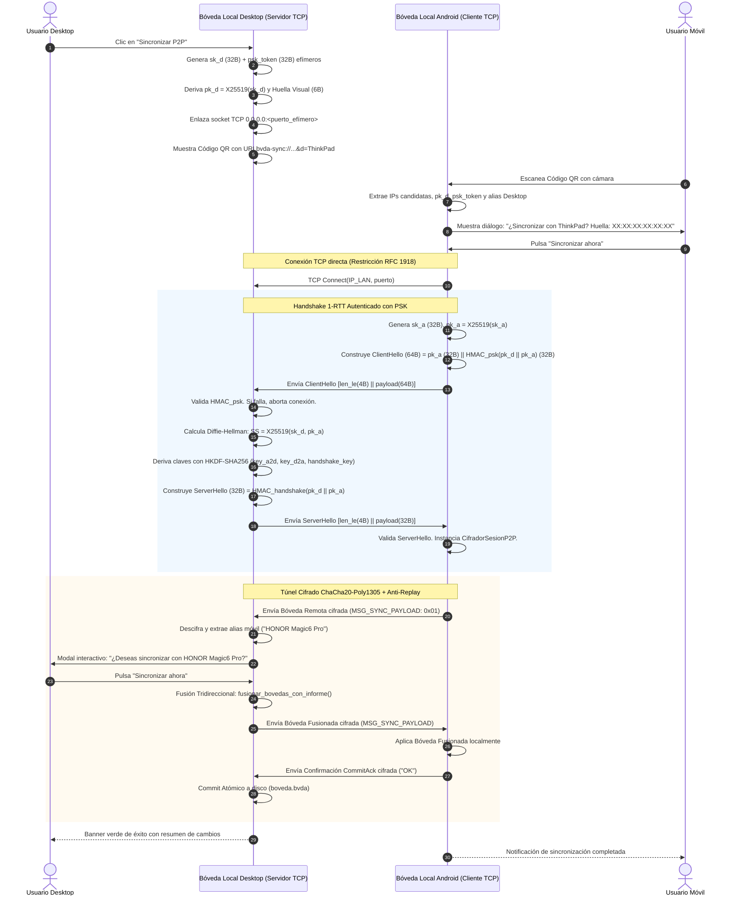
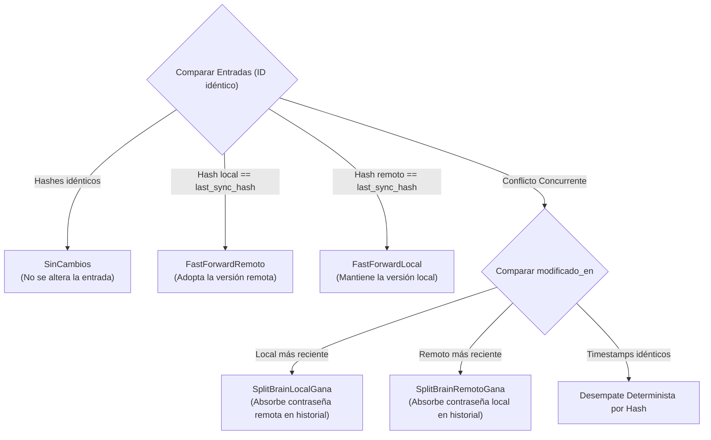
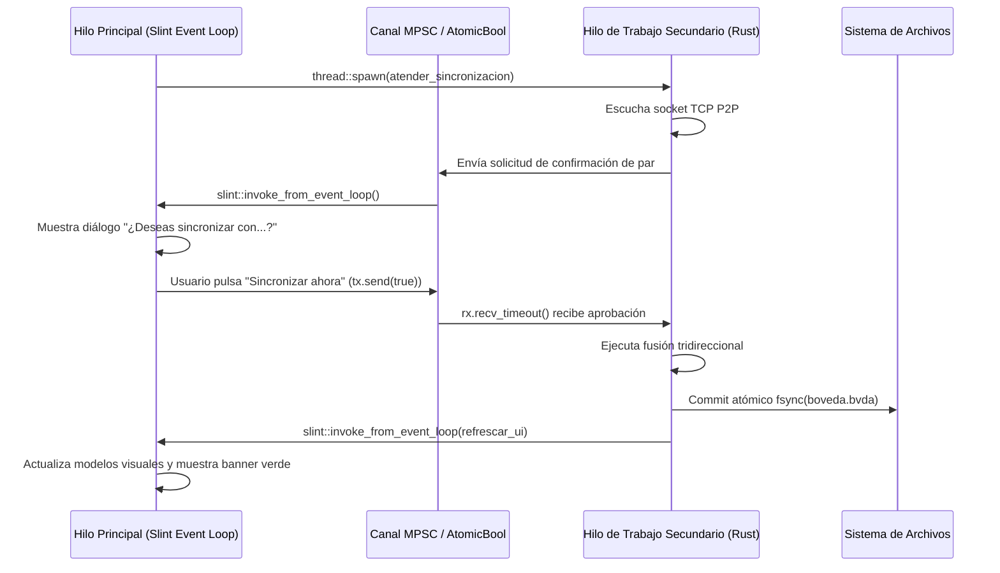

# Arquitectura Técnica de Bóveda Local Desktop

[]()
[]()
[](https://slint.dev/)
[]()
[]()

Este documento detalla la arquitectura técnica, el diseño criptográfico, los protocolos de sincronización descentralizada y las directivas de implementación de **Bóveda Local Desktop**, garantizando su completa interoperabilidad y simetría con la plataforma móvil [**Bóveda Local Android**](https://github.com/jlnavas3/boveda) (`com.jlnavas3.bovedalocal`).

---

## 1. Principios Fundamentales del Sistema

### 1.1 Confianza Cero en Red (Zero-Network Architecture)
Bóveda Local opera bajo la premisa de que los datos de autenticación no deben abandonar el dispositivo hacia servidores en la nube. No existen servidores centrales, servicios de telemetría ni endpoints remotos de validación.

### 1.2 Regla de Micro-Diseño Desacoplado
Cada componente del sistema se rige por la regla estricta:
> **1 archivo = 1 struct, enum o función pura con una única responsabilidad bien definida.**

* **Cero efectos secundarios ocultos**: Las funciones de transformación de datos son deterministas y puras.
* **Aislamiento de dependencias**: La lógica criptográfica y de fusión no tiene dependencias con el framework de interfaz gráfica (Slint).
* **Paridad estructural con Android**: La organización de paquetes y archivos en Rust refleja la estructura de clases en Kotlin (`BovedaLocal`).

### 1.3 Seguridad en Memoria y Zeroización Criptográfica
* Los secretos en memoria (claves maestras, contraseñas intermedias, tokens PSK y escalares X25519) implementan el trait `Zeroize` y `ZeroizeOnDrop` del crate `zeroize`.
* Se evita el uso de buffers compartidos o copias innecesarias en memoria para mitigar vectores de extracción mediante volcados de memoria (*core dumps*).

---

## 2. Mapa de Capas Arquitectónicas

```mermaid
flowchart TD
    subgraph UI_Layer ["1. Capa de Presentación (Slint Declarativo)"]
        SlintViews["ui/*.slint<br/>(Pantallas, Diálogos Modales, Formularios)"]
        Theme["ui/theme.slint<br/>(Temas: Claro, Oscuro, AMOLED • 19 Paletas)"]
    end

    subgraph State_Layer ["2. Capa de Gestión de Estado y Control (Rust)"]
        GuiMain["src/gui_main.rs<br/>(Event Loop, Reactor Slint, Canales MPSC)"]
        VaultState["src/gui/state/vault_data.rs<br/>(GuiVaultState: Caché en memoria de bóveda)"]
        HealthModule["src/gui/state/health/<br/>(Auditor de Duplicados, Comunes y Débiles)"]
    end

    subgraph Domain_Layer ["3. Capa de Dominio y Modelos"]
        Models["src/models/<br/>ContenidoBoveda • Entrada • TipoEntrada • Passkey • Submodelos"]
        Hasher["src/sync/merge/entry_hasher.rs<br/>(Cálculo determinista de Content Hash)"]
    end

    subgraph Sync_Layer ["4. Capa de Fusión y Protocolos P2P"]
        Arbiter["src/sync/merge/arbiter.rs<br/>(Árbitro Tridireccional LWW)"]
        DiffMask["src/sync/merge/diff_mask.rs<br/>(MascaraCampos & InformeSincronizacion)"]
        P2P_LAN["src/sync/p2p/tcp_server.rs & tcp_client.rs<br/>(Handshake 1-RTT X25519 + ChaCha20-Poly1305)"]
        Optical["src/sync/p2p/optical_qr.rs<br/>(Códec Óptico Airgap + Ensamblador CRC32)"]
    end

    subgraph Crypto_Layer ["5. Capa Criptográfica Fundamental"]
        Argon2Kdf["src/crypto/kdf.rs (Argon2id RFC 9106)"]
        AesCipher["src/crypto/cipher.rs (AES-256-GCM NIST SP 800-38D)"]
        Compressor["src/crypto/compressor.rs (BLZ1 Deflate)"]
        TOTP["src/crypto/totp.rs (RFC 6238)"]
    end

    subgraph Persistence_Layer ["6. Capa de Persistencia Atómica"]
        AtomicCommit["src/crypto/vault.rs<br/>(Escritura Atómica en dos fases con fsync)"]
        Keyring["src/gui/state/biometrics.rs<br/>(Integración OS Keyring: Secret Service / Credential Locker)"]
    end

    UI_Layer <--> State_Layer
    State_Layer --> Domain_Layer
    State_Layer --> Sync_Layer
    Sync_Layer --> Domain_Layer
    Domain_Layer --> Crypto_Layer
    Crypto_Layer --> Persistence_Layer
```



---

## 3. Especificación del Contenedor de Bóveda Canónico (`.bvda`)

El archivo `.bvda` es un contenedor binario cifrado autenticado de 49 bytes de cabecera fija, seguido por el ciphertext comprimido con Deflate y el tag de autenticación Poly1305/GCM.

### 3.1 Estructura Binaria de la Cabecera (49 Bytes)

| Offset (Bytes) | Longitud | Campo | Tipo | Descripción |
| :--- | :--- | :--- | :--- | :--- |
| `0x00 .. 0x03` | 4 B | `MAGIC` | `ASCII` | Firma mágica fija: `BVDA` (`0x42, 0x56, 0x44, 0x41`). |
| `0x04` | 1 B | `VERSION` | `u8` | Versión del formato canónico (`0x01`). |
| `0x05 .. 0x14` | 16 B | `SALT` | `[u8; 16]` | Sal criptográfica aleatoria generada con CSPRNG. |
| `0x15 .. 0x18` | 4 B | `MEM_COST` | `u32` (BE) | Memoria en KiB para Argon2id (65536, 131072, 262144). |
| `0x19 .. 0x1C` | 4 B | `TIME_COST` | `u32` (BE) | Iteraciones para Argon2id (3, 4, 6). |
| `0x1D .. 0x20` | 4 B | `LANES` | `u32` (BE) | Paralelismo de hilos para Argon2id (4 lanes). |
| `0x21 .. 0x24` | 4 B | `KEY_LEN` | `u32` (BE) | Longitud de clave de salida en bytes (`0x00000020` = 32 B). |
| `0x25 .. 0x30` | 12 B | `NONCE` | `[u8; 12]` | Vector de Inicialización (IV) de 96 bits para AES-GCM. |

### 3.2 Vinculación AAD (Additional Authenticated Data)
Los 49 bytes íntegros de la cabecera se inyectan en el motor AES-GCM como **AAD**:
$$\text{Tag} = \text{AES-GCM-Tag}_{K}(\text{Nonce}, \text{AAD}_{49\text{B}}, \text{Ciphertext})$$
Cualquier alteración en los parámetros de memoria, iteraciones o salt invalida el tag criptográfico y aborta la apertura antes de cualquier intento de descompresión o parsing JSON.

### 3.3 Compresión BLZ1
El cuerpo JSON se comprime con Deflate (zlib) precedido por el prefijo mágico de 4 bytes:
`0x42, 0x4C, 0x5A, 0x31` (`"BLZ1"`).
Si el payload no inicia con `"BLZ1"`, el lector lo interpreta como JSON plano retrocompatible.

---

## 4. Protocolo de Sincronización Wi-Fi LAN P2P (`bvda-sync://`)

### 4.1 Diagrama de Secuencia del Túnel P2P



### 4.2 Huella Visual Determinista de 6 Bytes
Para impedir ataques de intermediario (*Man-in-the-Middle*), el sistema genera una huella canónica a partir de la clave pública del Desktop y el token PSK del código QR:
$$\text{Huella} = \text{SHA-256}(\text{pk\_desktop}_{32\text{B}} \parallel \text{psk\_token}_{32\text{B}})[0..6]$$
Formateada en hexadecimal con separadores de dos puntos:
`74:5A:63:02:1A:A5`. Ambos usuarios cotejan que la huella mostrada en la pantalla de la computadora sea idéntica a la visualizada en la pantalla del teléfono.

---

## 5. Protocolo de Transporte Óptico Cifrado Airgap (`bvda-opt://`)

Diseñado para entornos herméticos (*air-gapped*) donde los dispositivos no comparten red local o tienen interfaces telemáticas desactivadas por política de seguridad.

```mermaid
flowchart TD
    subgraph Emisor ["Dispositivo Emisor (Desktop o Android)"]
        VaultSrc["ContenidoBoveda (Completa o Delta)"] --> JSON["JSON Compacto"]
        JSON --> ZlibComp["Compresión Zlib RFC 1950"]
        PIN["PIN Efímero 6 Dígitos"] & Salt["ID Sesión (4 Bytes Hex)"] --> KDF_Opt["SHA-256('BVDA-OPT-V1:' || ID || ':' || PIN)"]
        ZlibComp & KDF_Opt --> ChaChaEnc["Cifrado ChaCha20-Poly1305<br/>Nonce 12x0x00 • AAD: 'BVDA-OPT-V1:' || ID"]
        ChaChaEnc --> CRC["Cálculo CRC32 IEEE (Ciphertext Total)"]
        CRC --> Chunks["Chunking Dinámico (300 Bytes Máximo)"]
        Chunks --> URI["Formato Canónico bvda-opt://v1/idx/total/ID/CRC?d=Base64URL&a=Alias"]
        URI --> QRFrames["Ráfaga de Códigos QR Animados (5 FPS / 200 ms)"]
    end

    subgraph Receptor ["Dispositivo Receptor (Cámara)"]
        Camera["Sensor Cámara / Escáner"] --> ReadFrame["Lectura de Trama Individual"]
        ReadFrame --> Assembler["EnsambladorRafagaOptica<br/>(Detección de ID, Total, Chunks Desordenados)"]
        Assembler --> CheckCRC{"¿Todas las tramas recibidas?<br/>Verifica CRC32"}
        CheckCRC -- Fallo --> ErrorIntegridad["Error: Integridad CRC32 violada"]
        CheckCRC -- Correcto --> PromptPIN["Solicita PIN de 6 Dígitos al Usuario"]
        PromptPIN --> ChaChaDec["Descifrado ChaCha20-Poly1305"]
        ChaChaDec --> ZlibDecomp["Descompresión Zlib"]
        ZlibDecomp --> MergeTarget["Fusión Determinista con Bóveda Local"]
    end
```



### 5.1 Especificación de la Trama Óptica
Cada fotograma del código QR codifica un URI estandarizado:
```text
bvda-opt://v1/<indice>/<total>/<id_sesion_hex8>/<crc32_total_hex8>?d=<chunk_base64url>&a=<alias_emisor>
```
* **Chunking de 300 Bytes**: Al limitar cada fragmento a 300 bytes binarios, los códigos QR resultantes poseen versiones bajas (versión 8 a 10), produciendo módulos gruesos y nítidos legibles instantáneamente por la cámara.

---

## 6. Motor de Fusión Tridireccional y Arbitraje de Conflictos

El motor de fusión (`src/sync/merge/`) reconcilia dos versiones de una bóveda sin depender de un reloj centralizado y sin pérdida de datos.

### 6.1 Matriz de Decisiones del Árbitro (`DecisionArbitro`)



### 6.2 Preservación de Credenciales en Conflictos Split-Brain
Si un usuario modifica la contraseña de una entrada en su teléfono y simultáneamente en su computadora antes de sincronizar:
1. Gana la modificación con mayor timestamp `modificada_en` (o desempate por hash lexicográfico).
2. **Cero pérdida de credenciales**: La contraseña desplazada se absorbe automáticamente en la colección `historial_contrasenas` de la entrada ganadora, etiquetada con la marca temporal del conflicto.

### 6.3 Propagación Determinista de la Papelera
Las eliminaciones no borran inmediatamente el registro si existe sincronización pendiente. Se marcan con `eliminada_en: Some(timestamp)`. El árbitro compara si la fecha de eliminación es posterior a la última modificación del dispositivo par para decidir si la entrada debe transicionar a la papelera en ambos extremos.

---

## 7. Arquitectura de la Interfaz de Usuario (Slint UI)

### 7.1 Modelo de Concurrencia y Eventos
Slint opera en el hilo principal de la aplicación (*UI Event Loop*). Todas las operaciones I/O pesadas (sincronización TCP, derivación Argon2id, compresión zlib y escaneo de salud) se delegan a hilos de trabajo secundarios (`thread::spawn`).



### 7.2 Temas y Accesibilidad Visual
* **Temas Base**: Claro (Light), Oscuro (Dark) y Negro Puro (AMOLED).
* **19 Paletas Cromáticas de Acento**: Azul Canónico, Verde Esmeralda, Púrpura, Ámbar, Carmesí, Cian, Índigo, etc.
* **Escalado Dinámico**: Motor de detección de escala DPI y selector de zoom ergonómico (85% a 130%) con persistencia de preferencias en `config.toml`.

---

## 8. Matriz de Simetría e Interoperabilidad (Rust vs Android)

La siguiente tabla resume la correlación exacta entre los módulos de **Bóveda Local Desktop** y la aplicación hermana [**Bóveda Local Android**](https://github.com/jlnavas3/boveda) (`com.jlnavas3.bovedalocal`):

| Componente Arquitectónico | Bóveda Local Desktop (Rust) | Bóveda Local Android (Kotlin) |
| :--- | :--- | :--- |
| **Derivación KDF** | `argon2` crate (RFC 9106) | `de.nycode.bcrypt` / Argon2id JVM |
| **Cifrado Bóveda** | `aes-gcm` (NIST SP 800-38D) | `javax.crypto.Cipher` (AES/GCM/NoPadding) |
| **Compresión de Bóveda** | `flate2` (BLZ1 Deflate) | `java.util.zip.Deflater` (BLZ1) |
| **Intercambio X25519** | `x25519-dalek` v2.0 (RFC 7748) | `X25519.kt` (RFC 7748 puro en Kotlin) |
| **KDF de Sesión P2P** | `hkdf` / `hmac` SHA-256 (RFC 5869) | `HKDF.kt` / `Mac.getInstance("HmacSHA256")` |
| **Cifrado de Túnel P2P** | `chacha20poly1305` (RFC 8439) | `CifradorSesionP2P.kt` (ChaCha20-Poly1305 JVM) |
| **Detección IP LAN** | `getifaddrs` / sockets locales | `NetworkCapabilities` / `NetworkInterface` |
| **Framing de Red** | Little-Endian `[u32][payload]` | `WireProtocol.kt` Little-Endian `[u32][payload]` |
| **Códec Óptico Airgap** | `flate2::ZlibEncoder` + Base64URL | `java.util.zip.Deflater` + Base64 URL-safe |
| **Integridad de Ráfaga** | `crc32fast` (IEEE 802.3) | `java.util.zip.CRC32` |
| **UI Framework** | Slint v1.9 Native | Jetpack Compose + Material 3 |

---

## 9. Verificación de Calidad y Tests Automatizados

La confiabilidad del software se valida mediante una batería exhaustiva de pruebas unitarias y de integración que se ejecutan sin dependencias externas:

* **Suite de Tests (146 pruebas en verde)**:
  * `test_arbiter.rs`: Verificación de decisiones de fast-forward y resolución split-brain.
  * `test_diff_mask.rs`: Verificación de máscaras de diff por campo y cambios en historial.
  * `test_p2p_sync.rs`: Sincronización completa cliente-servidor en sockets TCP reales con rechazo de autenticación y confirmación interactiva.
  * `test_session_crypto.rs`: Validación del Vector de Oro RFC 7748 y mitigación de ataques de repetición.
  * `test_optical_qr.rs`: Empaquetado, fragmentación, descifrado con PIN y ensamblado de ráfagas desordenadas.
  * `test_sync_uri.rs`: Parsing estricto y validación de rangos privados RFC 1918.
  * `test_vault_merge.rs`: Fusión de bóvedas disjuntas y preservación de identidades.
* **Inspección Estática Clippy**:
  ```bash
  cargo clippy --all-targets -- -D warnings
  ```
  El proyecto mantiene **cero advertencias y cero errores** bajo las reglas más rigurosas del compilador de Rust.
