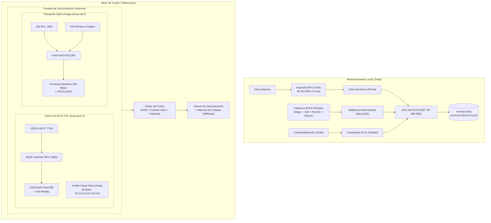

# Bóveda Local Desktop

[](https://www.rust-lang.org/)
[](https://slint.dev/)
[]()
[]()
[]()
[]()
[](https://www.gnu.org/licenses/gpl-3.0)

**Bóveda Local Desktop** es el cliente de escritorio oficial y soberano (Linux y Windows) para la gestión ultra-segura de credenciales, autenticación de dos factores (**TOTP RFC 6238**), llaves de acceso (**Passkeys / WebAuthn FIDO2**), identidades, notas seguras y sincronización descentralizada entre pares (**P2P**).

Diseñado desde sus cimientos en **Rust** bajo la regla estricta de **Micro-Diseño desacoplado** (1 archivo = 1 responsabilidad pura, cero efectos secundarios), opera con paridad binaria y criptográfica total con la aplicación móvil **Bóveda Local Android** (`com.jlnavas3.bovedalocal`).

---

## 🎯 Filosofía y Principios de Diseño

1. **Soberanía Absoluta y Confianza Cero en Nube (Zero-Knowledge / Zero-Network)**:
   Tus contraseñas, tokens y llaves privadas jamás tocan un servidor remoto ni servicios comerciales de almacenamiento en la nube. Toda operación ocurre estrictamente en tu hardware local.
2. **Seguridad en Memoria con Rust**:
   Inmunidad matemática contra *buffer overflows*, condiciones de carrera y *use-after-free*. Las claves maestras y secretos efímeros se protegen mediante estructuras dedicadas con sobreescritura estricta de memoria (*zeroization*) al salir de ámbito.
3. **Paridad Criptográfica de Bóveda Canónica (`.bvda`)**:
   Compatibilidad simétrica nativa para crear, abrir, inspeccionar, fusionar y compactar archivos `.bvda` intercambiables con la app móvil.
4. **Sincronización P2P Soberana en Red Local y Airgap Óptico**:
   Conexión directa entre la computadora y el teléfono sin pasar por internet, mediante sockets TCP efímeros sobre Wi-Fi privado (**RFC 1918**) o a través de **transporte óptico por cámara (ráfagas QR)** para entornos de máximo aislamiento físico (*air-gapped*).

---

## 🏗️ Diagrama General de Arquitectura Criptográfica



---

## ⚡ Características Principales

### 🔐 Criptografía y Seguridad de Datos
* **Derivación de Clave Argon2id (RFC 9106)**: Soporte para tres perfiles de seguridad:
  * **Estándar**: 64 MiB RAM, 3 iteraciones, 4 hilos (~150 ms).
  * **Reforzado**: 128 MiB RAM, 4 iteraciones, 4 hilos (~300 ms).
  * **Ultra-Seguro**: 256 MiB RAM, 6 iteraciones, 4 hilos (~600 ms).
* **Cifrado Autenticado AES-256-GCM**: Vector de inicialización CSPRNG de 96 bits único por guardado; cabecera de 49 bytes vinculada criptográficamente como datos autenticados asociados (**AAD**).
* **Compresión BLZ1 Transparente**: Payload comprimido con Zlib Deflate antes del cifrado, optimizando espacio y velocidad I/O.
* **Purga de Memoria (`zeroize`)**: Borrado seguro de contraseñas intermedias y claves derivadas en memoria volátil.
* **Integración con Llavero Biométrico del Sistema**: Desbloqueo rápido mediante el keyring del sistema operativo (*Secret Service / libsecret* en Linux, *Credential Locker* en Windows).

### 🗃️ Modelo de Datos Enriquecido (Paridad 100% con Android)
* **Tipos de Entradas**: Inicios de sesión, Tarjetas bancarias, Cuentas bancarias, Documentos de identidad, Servidores SSH/RDP/FTP, Contactos, Notas seguras y Llaves SSH.
* **Soporte Nativo de Passkeys (WebAuthn / FIDO2)**: Almacenamiento estructurado de `credentialId` (hex), `relyingParty`, `userHandle`, algoritmo de firma y contador.
* **Multi-URL y Paquetes de Aplicación**: Manejo diferenciado de URLs web estándar y esquemas de paquetes móviles (`androidapp://`).
* **Autenticación TOTP (RFC 6238)**: Algoritmos SHA-1, SHA-256 y SHA-512; intervalos de 30 o 60 segundos; 6 u 8 dígitos; barra de progreso y temporizador en tiempo real con copia rápida al portapapeles.
* **Historial de Contraseñas Antiguas**: Registro cronológico de contraseñas previas por entrada para evitar pérdidas de acceso en cambios de servicio.
* **Categorías y Etiquetas Dinámicas**: Organización multidimensional personalizable con selector de color y filtros rápidos.
* **Papelera de Reciclaje Inteligente**: Registro de fecha de eliminación para permitir la propagación determinista de borrados entre dispositivos durante la sincronización.

### 🌐 Sincronización Soberana P2P y Transporte Óptico
* **Protocolo LAN P2P (`bvda-sync://`)**:
  * Negociación de claves asimétrica **X25519 (RFC 7748)** con **HKDF-SHA256 (RFC 5869)**.
  * Cifrado bidireccional con **ChaCha20-Poly1305 (RFC 8439)** y control estricto de anti-repetición (*Anti-Replay Counter*).
  * Servidor TCP efímero en puerto dinámico con detección de interfaces privadas **RFC 1918** (`10.0.0.0/8`, `172.16.0.0/12`, `192.168.0.0/16`).
  * **Huella Visual Determinista de 6 Bytes** (ej. `51:A3:AF:4E:02:A4`) cotejada en pantalla para protección total contra ataques Man-in-the-Middle (MitM).
  * **Pre-anuncio de Identidad y Confirmación Interactiva**: Intercambio de alias del equipo (`aliasDispositivo`) con diálogo interactivo en Desktop (`«¿Deseas sincronizar con HONOR Magic6 Pro?»`) antes de aplicar cualquier fusión a disco.
* **Transporte Óptico Airgap por Ráfagas QR (`bvda-opt://`)**:
  * Para computadoras o dispositivos sin conectividad de red local.
  * Compresión Zlib + cifrado ChaCha20-Poly1305 protegido por **PIN efímero de 6 dígitos**.
  * Fragmentación en trozos de 300 bytes binarios que generan códigos QR de módulos grandes y alto contraste.
  * Reensamblador tolerante a ráfagas fuera de orden y tramas duplicadas con validación de integridad **CRC32 IEEE 802.3**.
  * Soporte de modo **Cambios Recientes (Delta 1 QR)** para sincronizaciones ultrarrápidas de un solo escaneo.

### 📊 Salud de la Bóveda y Auditoría de Seguridad
* **Detector de Contraseñas Duplicadas**: Identificación y conteo canónico de credenciales compartidas entre múltiples servicios.
* **Medidor de Fuerza Criptográfica (`zxcvbn`)**: Estimación realista de entropía y tiempo de descifrado contra ataques de fuerza bruta.
* **Base de Contraseñas Comprometidas**: Verificación local contra diccionario canónico de las contraseñas más filtradas del mundo (`common_passwords.txt`), sin enviar ninguna consulta a internet.
* **Kit de Emergencia**: Generación y exportación de documento de respaldo con instrucciones maestras de recuperación.
* **Importación y Exportación Flexible**:
  * Ingesta de bóvedas exportadas desde Bitwarden (JSON) y CSV genérico con mapeo inteligente de columnas.
  * Exportación cifrada `.bvda`, JSON plano y CSV para auditoría personal.

### 🎨 Experiencia de Usuario (UI) en Slint
* **Renderizado Nativo de Alto Rendimiento**: Interfaz fluida y reactiva construida con [Slint](https://slint.dev/) compilada directamente a código máquina nativo.
* **Temas y Personalización**: Modos Claro, Oscuro y AMOLED profundo con **19 paletas cromáticas de acento**.
* **Escalado y Zoom Dinámico**: Ajuste automático a la resolución del monitor y selector de zoom ergonómico (85% a 130%).
* **Búsqueda en Tiempo Real y Atajos de Teclado**: Navegación ágil por categorías, servicios, usuarios y etiquetas con soporte completo para teclado.

---

## 📂 Estructura del Proyecto

```text
BovedaLocalDesktop/
├── Cargo.toml                  # Dependencias y configuración de compilación de Rust
├── build.rs                    # Integración de compilación del frontend Slint
├── LICENSE                     # Licencia pública GNU General Public License v3.0 (GPLv3)
├── README.md                   # Documentación general y guía de inicio rápido
├── ARQUITECTURA.md             # Especificación técnica detallada y diagramas de flujo
├── ui/                         # Código fuente de interfaz gráfica Slint (.slint)
│   ├── app_window.slint        # Ventana principal e integración de componentes
│   ├── theme.slint             # Sistema de diseño, paletas y tipografía
│   ├── screens/                # Pantallas: principal, detalle, ajustes
│   ├── dialogs/                # Modales: sincronización P2P, visor QR, confirmaciones
│   ├── edit/                   # Formularios de edición especializados por submodelo
│   └── assets/                 # Iconografía SVG nativa y recursos visuales
├── src/                        # Código fuente del backend en Rust
│   ├── main.rs                 # Punto de entrada para la CLI (boveda-cli)
│   ├── gui_main.rs             # Punto de entrada para la GUI (boveda-gui)
│   ├── lib.rs                  # Exportación de la biblioteca boveda_core
│   ├── config/                 # Configuración de usuario y persistencia de ajustes
│   ├── crypto/                 # Motor criptográfico (Argon2id, AES-GCM, BLZ1, TOTP, etc.)
│   ├── models/                 # Modelos de datos estructurados (Entrada, Perfil, etc.)
│   ├── gui/                    # Estado en memoria, motor de búsqueda, salud y zoom
│   └── sync/                   # Módulo de sincronización
│       ├── merge/              # Árbitro tridireccional, máscaras de diff y reportes
│       └── p2p/                # Wire protocol, TCP efímero, handshake X25519, QR óptico
└── tests/                      # Suite de pruebas de integración (146 tests)
```

---

## 🚀 Compilación y Ejecución

### Prerrequisitos
* **Rust** (versión estable 1.80 o superior): [rustup.rs](https://rustup.rs/)
* **Dependencias de Sistema en Linux** (para Slint, portapapeles y keyring):
  * **Ubuntu / Debian**:
    ```bash
    sudo apt update
    sudo apt install -y build-essential cmake libfontconfig1-dev libxcb-render0-dev \
        libxcb-shape0-dev libxcb-xfixes0-dev libxkbcommon-dev libsecret-1-dev
    ```
  * **Fedora / RHEL**:
    ```bash
    sudo dnf install -y gcc gcc-c++ cmake fontconfig-devel libxcb-devel \
        libxkbcommon-devel libsecret-devel
    ```

### Ejecutar la Suite de Pruebas
Ejecuta la batería completa de 146 pruebas unitarias y de integración:
```bash
cargo test
```

### Verificación de Calidad con Clippy (Cero Advertencias)
```bash
cargo clippy --all-targets -- -D warnings
```

### Ejecutar en Modo Desarrollo (GUI)
```bash
cargo run --bin boveda-gui
```

### Compilar el Binario Optimizado para Producción
```bash
cargo build --release --bin boveda-gui
```
El binario ejecutable independiente quedará generado en:
```text
target/release/boveda-gui
```

---

## 🤝 Interoperabilidad con Bóveda Local Android

Bóveda Local Desktop está diseñado para coexistir en perfecta sincronía con **Bóveda Local Android**:
* Mismo formato canónico de almacenamiento cifrado `.bvda` (versión 1).
* Mismo vector de oro para el handshake X25519 y derivación HKDF-SHA256.
* Idéntico cálculo de huellas visuales deterministas (`XX:XX:XX:XX:XX:XX`).
* Misma estructura JSON de serialización para todas las categorías de entradas y submodelos.

---

## 📄 Licencia

Este proyecto se distribuye bajo los términos de la **GNU General Public License v3.0 (GPLv3)**. Consulta el archivo [LICENSE](LICENSE) para más detalles.
